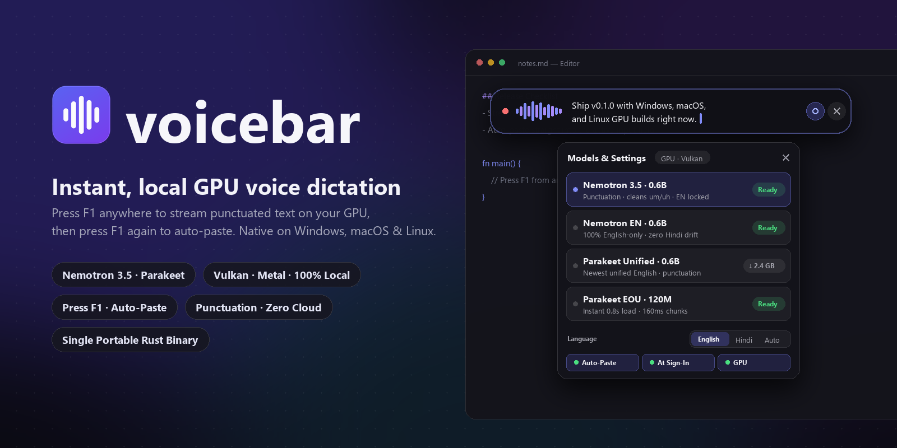

<p align="center">
  
</p>

<p align="center">
  <a href="https://github.com/boparaiamrit/voicebar/releases/latest"></a>
  <a href="https://github.com/boparaiamrit/voicebar/actions/workflows/ci.yml"></a>
  
  
  <a href="LICENSE"></a>
</p>

<p align="center">
  <a href="#install">Install</a> ·
  <a href="#quick-start">Quick start</a> ·
  <a href="#models">Models</a> ·
  <a href="#portable-mode">Portable mode</a> ·
  <a href="#privacy--security">Privacy</a> ·
  <a href="#build-from-source">Build</a>
</p>

---

**voicebar** is one native Rust binary that gives you Wispr Flow–style floating real-time voice
dictation **100% locally on your GPU**. Press **`F1`** from any window — a borderless, focus-free
pill floats at the top of your screen and streams punctuated text live as you speak. Press **`F1`**
again to copy and auto-paste straight into your active input field.

No cloud API keys, no monthly subscriptions, no Python runtime, no CUDA toolkit install, and your
voice never leaves your computer.

## Highlights

- **True streaming on your GPU — no Whisper flicker.** Uses NVIDIA's cache-aware FastConformer
  streaming models (`Nemotron 3.5`, `Nemotron EN`, `Parakeet Unified`, `Parakeet EOU`) running
  natively in pure Rust via **Burn + Vulkan** (Windows/Linux) and **Burn + Metal** (Apple Silicon).
- **Press `F1`, speak, press `F1` to paste.** Appears at the top of your monitor without stealing
  focus from VS Code, your browser, Slack, or terminal. On the second `F1`, it flushes the final
  word, copies to the clipboard, sends `Ctrl+V` (`⌘V` on macOS), flashes **Pasted**, and vanishes.
- **Built-in punctuation, capitalization, and filler cleanup.** `Nemotron 3.5` drops `um` and `uh`
  and outputs crisp punctuated prose directly — locked to `en-US` by default so Indian/global
  English accents never drift into Hindi script (switchable to `Hindi` or `Auto` in one click).
- **Four local GPU models, one click away.** Click the settings icon on the floating pill (or in
  the system tray) to open the separate floating **Models & Settings** card and switch between
  0.6B flagship accuracy and 0.8-second instant-start 120M streaming.
- **Zero-wait startup.** Enable **Start at Sign-In** so Voicebar silently preloads weights onto
  your GPU once at boot (the tray icon turns from amber while warming to indigo when ready).
- **Single portable binary.** No CUDA SDK, no ONNX Runtime DLLs, no Python, no Electron. Drop a
  `portable.txt` next to `voicebar.exe` to keep models and settings portable beside the binary.

## Why

Cloud dictation apps charge monthly fees and upload everything you say. Local Whisper wrappers
re-transcribe 30-second sliding windows over and over, making live words jump around and rewrite
in front of you.

| Problem | What voicebar does |
| --- | --- |
| Monthly subscriptions & cloud audio uploads | Runs 100% locally on your GPU — free, private, offline after model download |
| Whisper's 30 s window rewrites & flicker | Cache-aware streaming (`160 ms`–`560 ms` chunks) emits words smoothly once |
| CUDA toolkit / Python / DLL setup pain | Pure-Rust `burn` GPU kernels over **Vulkan** (Windows/Linux) and **Metal** (macOS) |
| Floating popups stealing cursor focus | Non-activating `WindowKind::PopUp` overlay keeps your cursor in the target input |
| Heavy Electron memory footprint | Native **GPUI Kit** UI in one Rust binary; idles silently in the tray |

## Install

Download the package for your system from the
[latest release](https://github.com/boparaiamrit/voicebar/releases/latest):

| System | Installer | Or portable archive |
| --- | --- | --- |
| Windows (x64) | `voicebar-<version>-windows-x64-setup.exe` | `voicebar-<version>-windows-x64.zip` |
| macOS (Apple silicon) | `voicebar-<version>-macos-arm64.dmg` | — |
| Ubuntu 24.04+, Debian 13+ (x64) | `voicebar-<version>-linux-x64.deb` | `voicebar-<version>-linux-x64.tar.gz` |
| Fedora 40+, RHEL 10+ (x64) | `voicebar-<version>-linux-x64.rpm` | `voicebar-<version>-linux-x64.tar.gz` |

Each release is built, unit-tested, and package-tested by GitHub Actions on its own operating
system before it is published.

**Windows.** Run the setup (no administrator rights needed) or unzip the portable `.zip` anywhere.
The installer is not code-signed yet, so SmartScreen may warn the first time: choose **More info**,
then **Run anyway**.

**macOS.** Open the `.dmg` and drag **Voicebar** to Applications. On first launch, right-click →
**Open**, then grant **Microphone** and **Accessibility** permissions (Accessibility enables
global `F1` and `⌘V` auto-paste).

**Linux.**

```bash
sudo apt install ./voicebar-<version>-linux-x64.deb   # Ubuntu, Debian
sudo dnf install ./voicebar-<version>-linux-x64.rpm   # Fedora, RHEL
```

*(For Linux auto-paste, install `xdotool` on X11 or `wtype` on Wayland.)*

## Quick start

1. Launch **Voicebar** — it appears in your system tray (menu bar on macOS).
   - **Amber icon:** preloading model onto GPU.
   - **Indigo icon:** warm and ready (`< 30 ms` wake on `F1`).
   - **Crimson icon:** actively listening.
2. Click into any text input (VS Code, browser, Slack, terminal) and press **`F1`**.
   - On the very first run, Voicebar automatically downloads the selected model from Hugging Face
     with a live progress bar inside the pill.
3. Speak normally — words stream live in front of you.
4. Press **`F1`** again — Voicebar flushes the final word, copies to clipboard, auto-pastes into
   your input, flashes **Pasted**, and hides.

## Models

Switch models anytime from the **Settings** icon on the pill or from the system tray menu:

| Model | Latency | Size | Cold GPU load | Best for |
| --- | --- | --- | --- | --- |
| **Nemotron 3.5 · 0.6B** *(default)* | `560 ms` | ~2.5 GB | ~15 s | Punctuation, capitalization, removes `um`/`uh`, locked to `en-US` (40 langs available) |
| **Nemotron EN · 0.6B** | `560 ms` | ~2.4 GB | ~15 s | 100% English-only specialist, verbatim with punctuation (zero non-English drift) |
| **Parakeet Unified · 0.6B** | `560 ms` | ~2.4 GB | ~15 s | NVIDIA's newest 100% English-only unified streaming model with punctuation |
| **Parakeet EOU · 120M** | `160 ms` | ~460 MB | **~0.8 s** | Ultra-fast startup, lightweight VRAM (~0.5 GB), English |

Benchmarked on an **NVIDIA GeForce RTX 5070 Laptop GPU (Vulkan)**: `Nemotron 3.5 · 0.6B` runs at
**~100–145 ms per 560 ms chunk (`3.2x` faster than real time)**, and `Parakeet EOU · 120M` runs at
**~30 ms per 160 ms chunk (`5x` faster than real time)**.

## Portable mode

By default, settings and downloaded models live in:
- **Windows:** `%LOCALAPPDATA%\voicebar\`
- **macOS:** `~/Library/Application Support/voicebar/`
- **Linux:** `~/.local/share/voicebar/`

To run fully portable (for example on a USB drive or synced folder), create an empty `portable.txt`
file or a `voicebar-data/` directory next to the `voicebar` binary.

## CLI helpers

```powershell
voicebar --version                     # print version
voicebar --download                    # pre-download the active model
voicebar --download --model eou        # pre-download Parakeet EOU 120M
voicebar --test-wav sample.wav         # benchmark live GPU streaming on a WAV file
voicebar --cpu                         # force CPU Burn backend
```

## Privacy & Security

- **100% offline inference.** Audio is captured directly from your OS microphone (`cpal`) and
  processed strictly on your local GPU/CPU. Zero audio bytes ever leave your machine.
- **Network used only for model downloads.** Weights are fetched directly over HTTPS from Hugging
  Face (`altunenes/parakeet-rs`) with atomic `.part` writes.
- **Single-instance local lock.** Binds only to `127.0.0.1:7981` to toggle an existing instance.

## Build from source

```powershell
# Windows (requires VS 2022 C++ Build Tools)
cargo build --release -j 4

# macOS (Apple Silicon — uses Metal GPU backend automatically)
cargo build --release

# Linux (install Vulkan, ALSA, XKB, D-Bus dev headers — see .github/workflows/ci.yml)
cargo build --release
```

## Layout

```text
src/
  main.rs       single-instance lifecycle, two-window pill + settings orchestration, CLI
  overlay.rs    Dynamic Island floating capsule and Models & Settings popover (GPUI Kit)
  engine.rs     dedicated GPU streaming ASR worker (parakeet-rs on Burn Vulkan / Metal)
  audio.rs      WASAPI / CoreAudio / ALSA mic capture + 16 kHz linear resampler + waveform
  hotkey.rs     global F1 listener, auto-paste (SendInput / osascript / xdotool), Windows DWM border strip
  tray.rs       system tray / menu bar icon (amber/indigo/crimson) and menu
  config.rs     model manifests, portable data paths, sign-in autostart
  download.rs   atomic Hugging Face streaming downloader with progress
assets/         multi-size Windows .ico and 512x512 PNG icon
packaging/      Windows Inno Setup script and Linux .desktop file
.github/        CI and cross-platform Windows, macOS & Linux release workflows
```

## License

[MIT](LICENSE) © Amritpal Singh
